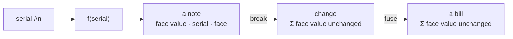

<div align="center">
  

  CA: https://pump.fun/coin/Gkdg5vEwpGXmtEzm2t7KQ7dBfVrkhh1Tf72Dhjjzpump

  <h1>Nacreum</h1>
  <p><strong>A currency that comes in notes — money with denominations, on Solana.</strong></p>

  <p>
    <a href="http://nacreum.xyz/"></a>
    <a href="https://x.com/nacreumcash"></a>
    <a href="https://github.com/nacreumlabs/nacreum"></a>
  </p>
  <p>
    <a href="https://github.com/nacreumlabs/nacreum/releases"></a>
    <a href="https://github.com/nacreumlabs/nacreum/pkgs/npm/note-engine"></a>
    <a href="LICENSE"></a>
    
    
  </p>
</div>

---

> Every other coin is **one flat number**, divisible forever. That isn't sophistication — it's
> the state money sat in *before* Lydia struck the first coin and turned "weigh this dust" into
> "count these pieces." **Nacreum** puts the **denomination** back: a billion discrete **notes**,
> each with a face value, a serial, and a face — notes you can **break** into change and **fuse**
> back into a bill, on-chain, where the total face value can never be quietly printed or burned.

## Contents

- [What it is](#what-it-is)
- [Features](#features)
- [How it works](#how-it-works)
- [The note engine](#the-note-engine)
- [On-chain (the primitive)](#on-chain-the-primitive)
- [Repository layout](#repository-layout)
- [Run it yourself](#run-it-yourself)
- [Roadmap](#roadmap)
- [Disclaimers](#disclaimers)
- [Links](#links)

## What it is

Three parts, one repo:

| Layer | What | Where |
|-------|------|-------|
| **The site** | The conceptual document, in a text-terminal aesthetic — with a live **note minter** that draws any note from its serial, right in the browser. | [`index.html`](index.html) |
| **The primitive** | The on-chain design: denominated notes with **break** / **fuse** and a hard total-face-value **conservation** invariant. | [`programs/nacreum/`](programs/nacreum/) · [`docs/`](docs/ARCHITECTURE.md) |
| **The engine** | `note = f(serial)` as a reusable, dependency-free package — recompute and verify any note offline. | [`packages/note-engine/`](packages/note-engine/) |

## Features

**The site** (`index.html`, `variants/serif/`)
- 🏦 **Mint a note** — deterministic `note = f(serial)`; type any serial `1…1e9` and the exact
  pixel banknote is drawn on the spot. Nothing stored, anyone can recompute it.
- 🔀 **Break & fuse workbench** (serif variant) — split a note into change, fuse change into a
  bill, with a running **"total face value — conserved ✓"** readout that never moves.
- 🗂️ **Chaptered prose** — the pitch, the denomination, the catalog of rarities, provenance,
  a short history of money, the spec.
- 🖥️ Retro tty / Lynx aesthetic · zero build step · self-contained · relative-path portable.

**The primitive** (`programs/nacreum/`)
- 💵 **Denominations** — money is a stack of discrete notes, each wearing a face value.
- ✂️ **Break** a big note into change · 🔗 **Fuse** change into a bill — both on-chain.
- ⚖️ **Conservation** — break and fuse *never* change the total face value; only minting
  (bounded by a supply cap) may increase it.
- 🧬 **Provenance** — a note remembers every hand it passed through.
- 🏷️ **Rarity** — high denominations, misprint "error" notes, fancy serials (radar/solid/ladder).

**The engine** (`@nacreumlabs/note-engine`)
- 🧮 Pure `generate(serial)` → the full note descriptor · `svg(note)` → an `<svg>` string.
- 🔍 Verifiable by design: run it yourself, compare to the chain. No dependencies.

## How it works



Appearance is never stored — it is a pure function of the serial, so the browser, the package,
and any on-chain-adjacent tooling all agree and nothing can be forged. `break` and `fuse` only
**reshape** value; the one invariant the program must guarantee is that they never create or
destroy it. Full design in [`docs/ARCHITECTURE.md`](docs/ARCHITECTURE.md).

## The note engine

```bash
# .npmrc:  @nacreumlabs:registry=https://npm.pkg.github.com
npm install @nacreumlabs/note-engine
```

```js
const { generate, svg } = require('@nacreumlabs/note-engine');

const note = generate(777);
// { id: 777, nation: 'Toreholm', denom: 1, series: 'D',
//   rarity: 'common', special: 'low serial', serial: 'D-00000777', ... }

svg(note);                 // -> an <svg> string
svg(note, { denom: 50 });  // -> face value overridden (e.g. after a break/fuse)
```

## On-chain (the primitive)

Nacreum's real "backend" is a Solana program, not a web server. The WIP (⚠️ **not audited**)
Anchor skeleton in [`programs/nacreum/`](programs/nacreum/) models the primitive with real
conservation checks:

```
mint_note(denom)          minted += denom;  require minted <= supply_cap   // only this grows total
break_note(pieces)        require sum(pieces) == input.denom                // conserve
fuse_notes(inputs)        require output.denom == sum(inputs.denom)         // conserve
```

Serials are monotonic and **never reused**, so churning break↔fuse can't farm a rare serial
(`appearance = f(serial)`), and provenance stays honest. Scaling to a billion notes uses **state
compression**; see [`docs/ARCHITECTURE.md`](docs/ARCHITECTURE.md).

## Repository layout

```
nacreum/
├── index.html              # the site (static) — deployed to GitHub Pages → nacreum.xyz
├── style.css  *.woff       # the text-terminal look + bitmap font
├── variants/serif/         # the "Bank of Nacreum" skin + break/fuse workbench
├── packages/note-engine/   # @nacreumlabs/note-engine — note = f(serial)
├── programs/nacreum/        # WIP Anchor program: mint · break · fuse (conservation)
├── docs/ARCHITECTURE.md     # the on-chain design
├── Anchor.toml  Cargo.toml
└── LICENSE
```

## Run it yourself

```bash
git clone https://github.com/nacreumlabs/nacreum && cd nacreum

# the site — fully static, no build step
python -m http.server 8080          # http://127.0.0.1:8080/

# the engine
node -e "console.log(require('./packages/note-engine').generate(777))"
```

## Roadmap

- **P0 · plates** — generation function frozen & published · this document · minter & workbench. ✅
- **P1 · press** — fair launch on pump.fun · fancy-serial & error-note hunt.
- **P2 · billfold** — wallet connect · your notes drawn as a real billfold.
- **P3 · change** — `break` & `fuse` live on-chain, with conservation enforced.
- **P4 · ledger** — the retired-serial ledger & provenance browser.

## Disclaimers

Nacreum is a conceptual, community, and experimental project. Nothing here is financial advice;
it represents no equity, no yield, and no promise of return. Ticker `$NACRE` (placeholder),
contract address **TBA**. The Anchor program is a WIP skeleton and is **not audited**. Crypto is
volatile and can go to zero — do your own research.

## Links

- 🌐 Site — http://nacreum.xyz/ (fallback: https://nacreumlabs.github.io/nacreum/)
- 🐦 X — https://x.com/nacreumcash
- 💻 Source — https://github.com/nacreumlabs/nacreum
- 📦 Package — [`@nacreumlabs/note-engine`](https://github.com/nacreumlabs/nacreum/pkgs/npm/note-engine)
